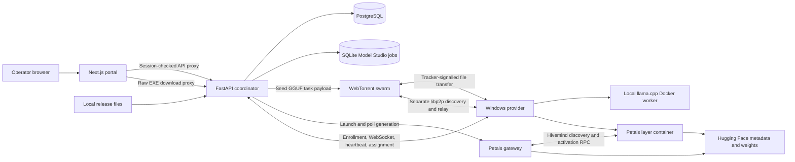

# ComputeTorrent architecture audit

Phase 0 baseline, 2026-11-06. Source inspected at `0f0d02d` with the supplied root `flow.md`. “Present” below means a source path exists. Runtime evidence and its limits are recorded in [testing-results.md](testing-results.md).

## Repository and stack

| Area                      | Canonical source and responsibility                                                                                                                                                                                                                                                                                                                                                            |
| ------------------------- | ---------------------------------------------------------------------------------------------------------------------------------------------------------------------------------------------------------------------------------------------------------------------------------------------------------------------------------------------------------------------------------------------- |
| Portal                    | `01-submitter-portal/` uses Next.js 14.2.35 Pages Router, React 18, TypeScript 5.2, and CSS modules. The Docker build uses Node 18.                                                                                                                                                                                                                                                            |
| Coordinator               | `orchestrator/app/main_production.py` runs Python 3.10, FastAPI 0.104.1, Uvicorn, Pydantic 2 and SQLAlchemy 2. PostgreSQL 18 persists providers, credentials and task accounting. `distributed.py` adds Model Studio jobs backed by a separate SQLite file. Active sockets and distributed job tasks are process-local.                                                                        |
| Domain modules            | `04-task-slicer-scheduler/` and `06-verification-engine/` are imported by the coordinator. `02-orchestrator-api/`, `03-database/`, `09-incentives-credits/` and `10-model-versioning/` provide module descriptions, not independent services in canonical Compose. `05-allocator-churn/` is a separate module from the active Model Studio placement function.                                 |
| Transport                 | `07-network-layer/` runs a Node 22 service with WebTorrent and js-libp2p. `08-provider-node/04-webtorrent-sync/` supplies the provider's Node helpers.                                                                                                                                                                                                                                         |
| Provider                  | `08-provider-node/05-desktop-app-shell/production_seeder.py` is the Windows CustomTkinter client. It uses psutil, hardware probes, Python websockets, Node helpers, and Docker Desktop. `inference_runtime.py` runs llama.cpp. `petals_control.py` manages CPU/CUDA containers built from `06-petals-runtime/`. Petals is pinned by commit and runs with PyTorch 2.2.2 in the runtime recipes. |
| Operations and validation | Root Compose, PowerShell and batch launchers run the local system. `11-evaluation-benchmark/` and `12-testing-validation/` contain mocks, unit checks and live smoke tools. `shared/` and `mock-server/` support earlier development workflows.                                                                                                                                                |
| Alternate tree            | `backend/`, `frontend/`, `desktop/`, and `docker/` are separate source and packaging paths. `infrastructure/` selects between stacks. A copied file does not establish parity for its callers, configuration or artifact. Audit findings refer to canonical paths unless stated otherwise.                                                                                                     |

## Inference and result delivery

1. **Model Studio.** `pages/inference.tsx` uploads a JSON/XML recipe through `/api/ct/distributed/jobs`. The coordinator validates the model catalog and prompt, checks available peers, resolves the Hugging Face revision to a commit, and stores the job. The catalog lists BLOOM 560M, BLOOMZ 560M and TinyLlama 1.1B Chat. Catalog membership alone is not model compatibility evidence.
2. **Placement and worker startup.** `distributed.py:placement` selects opted-in, idle, compatible Docker providers and allocates contiguous ranges using estimated block memory, reported RAM/VRAM and disk. The recipe defaults to one minimum peer and permits up to eight. `petals_start` carries the pinned model, block range, job prefix and DHT bootstrap. Workers check bootstrap reachability and report actual serving readiness, including peer ID. There is no measured link cost in the placement heuristic.
3. **Generation and verification.** The gateway runs `generate_job.py`. It loads tokenizer and model metadata, restricts the Petals route to assigned peers, and passes activations through stage sessions. Coordinator-side code generates tokens, commits boundary digests and compares tokens and activations against a trusted local replay. The canary traverses the same route. Results and errors flow from gateway polling to SQLite and then to Model Studio polling. Worker shutdown and job cancellation use explicit stop messages and lease handling. The source enforces one active Model Studio job per coordinator process and does not migrate a failed stage to a replacement peer during a run.
4. **GGUF task path.** `POST /api/tasks` is a distinct API. It checks the operator's model registry, slices prompt work, creates swarms and schedules replicas over the provider WebSocket. The provider validates payload hashes and runs llama.cpp in a read-only, network-disabled Docker container. The coordinator receives results and applies replica consensus, canary checks and audit receipts. History and result downloads read coordinator responses. A single reported result has weaker guarantees than replica consensus. Neither verification path establishes the full VeriLLM protocol.

## Peer lifecycle and networking

The provider takes a coordinator address and enrollment code, enrolls over HTTP(S), saves a revocable node credential, registers over WebSocket, and reports hardware and activity through heartbeats. It reconnects after transport failures. The coordinator keeps live state in memory and uses PostgreSQL for enrollment records. `production_seeder.py` launches the optional libp2p helper against the coordinator's bootstrap endpoint. Its explicit relay, mDNS and Kademlia discovery operate separately from WebTorrent file transfer, which uses configured trackers for WebRTC signalling. The Petals gateway has its own Hivemind DHT identity and TCP bootstrap. A working WebSocket or libp2p relay alone does not prove that Petals activation ports are reachable.

Tracked source contains no Tailscale integration, startup dependency, or provider requirement. Any manually configured tailnet is outside this checkout and was not inspected. The actual remote helper is `start-ngrok.ps1` / `Run-Ngrok.bat`. It tunnels coordinator HTTP/WebSocket on port 8001 and supplies an address through `runtime/public_tunnel.json` or the portal's inspector fallback. It does not tunnel the libp2p relay or the Petals TCP listener. LAN binds and advertised addresses must match the actual host. The repository has firewall helper scripts, but no verified automatic NAT/CGNAT traversal for all three transport paths.

## Installer, updates and portal

- `build_installer.ps1` builds the PyInstaller executable, ZIP with PowerShell install/uninstall scripts, release metadata, and optionally an Inno Setup EXE. `provider-setup.iss` installs per user with Start Menu integration. The portal's `/api/download-provider` streams the update feed's raw `ComputeTorrent_Seeder.exe`; it does not serve the Inno Setup artifact. Building replaces the local feed EXE and manifest using two separate file operations.
- `provider_update.py` derives the feed URL from the coordinator address, compares build strings, streams to a partial file with progress, and validates size and SHA-256. A frozen client launches a PowerShell helper that waits for exit, copies over the running executable and restarts it. Settings and caches are stored separately. There is no signed manifest, platform or channel selection, atomic executable replacement, or rollback. The updater explicitly disables TLS certificate and hostname verification.
- Portal routes are workspace `/`, Model Studio `/inference`, history, credits and login. `PortalNav.tsx`, `_app.tsx`, global styles and two CSS modules provide shared presentation. Components maintain local React state and fetch on intervals (4 seconds in Model Studio, 5 seconds on several other screens). The portal uses a signed operator session and server-side API token proxy. The dedicated provider download route does not check that session. Workspace contains fixed fallback onboarding values and the ngrok helper UI. There is no centralized typed client or cross-page state store.

## Findings and implementation status

| Priority | Finding                                                                                                                                        | Evidence and next phase                                                                                                                                                                                                                                                                                                                                                         |
| -------- | ---------------------------------------------------------------------------------------------------------------------------------------------- | ------------------------------------------------------------------------------------------------------------------------------------------------------------------------------------------------------------------------------------------------------------------------------------------------------------------------------------------------------------------------------- |
| P0       | Provider update authenticity is missing. A party controlling the connection can substitute both bytes and their digest when TLS is unverified. | `provider_update.py:_create_ssl_context`, public update feed and unsigned manifest. Phase 5.                                                                                                                                                                                                                                                                                    |
| P0       | A hardcoded development join value is accepted even when a private enrollment value is configured.                                             | `main_production.py:enroll_seeder` branches independently on the fallback. No live enrollment was attempted. Phases 2–3 and 9.                                                                                                                                                                                                                                                  |
| P1       | Public tunnel reachability can be mistaken for working inference transport.                                                                    | Ngrok script forwards 8001 only. Bootstrap/relay and Hivemind use separate addresses and ports. Phases 2–3.                                                                                                                                                                                                                                                                     |
| P1       | Download and release metadata drift.                                                                                                           | Portal serves raw EXE. Local feed reports `2026.11.03-update3`, while source build ID and on-disk Inno ProductVersion report `2026.11.01-update2`. The feed hash matches its payload, but this does not prove payload version or authenticity. Phase 5.                                                                                                                         |
| P1       | Malformed recipe types can escape the intended validation error handling.                                                                      | JSON null for `max_new_tokens` and a nonempty list for `model_id` both reproduced `TypeError` at the parser. The route catches `ValueError`. Phase 9 or the approved phase that first changes validation.                                                                                                                                                                       |
| P1       | Pilot job recovery and scale are limited.                                                                                                      | One active job, static stage assignment, job failure on startup disconnect, trusted full-model replay, no demonstrated cross-network recovery. Phases 8–10.                                                                                                                                                                                                                     |
| P2       | Onboarding and UI consistency gaps.                                                                                                            | Manual endpoint and enrollment, fixed fallback values, polling with loosely typed payloads, separate download and update UX. Phases 4–7.                                                                                                                                                                                                                                        |
| P2       | Reproducibility and deployment drift.                                                                                                          | Canonical swarm Dockerfile uses `npm install` without copying its tracked lockfile. Portal uses `npm install` and has no tracked lockfile. No tracked GitHub Actions workflow. Root launcher describes an optional Petals profile, but Compose resolves Petals as an ordinary service. Alternate Compose needs explicit environment-file selection from the root. Phases 10–11. |

The provider startup, bootstrap and readiness unit checks passed. Portal type checking and Compose configuration passed within the scope in [testing-results.md](testing-results.md). Live model execution, Windows installation and restart, cross-device reachability and production readiness are unverified in this phase.

## Phase 1 research implications

The active Model Studio path uses Petals and Hivemind to serve model blocks and route inference sessions. The coordinator chooses which providers load blocks, fixes their ranges for the job, and drives activations through the planned stage slices. Its RAM/VRAM heuristic determines capacity. It does not estimate per-device prefill/decode time or activation link cost, allocate cache budgets per request, or reserve redundant coverage for decode-time failover. The separate planner helpers do not change the active path.

The closest first comparison with Sun et al. is a single coordinator-client experiment. Use real container runtime capacity, model and KV-cache measurements and activation-sized coordinator-to-worker round trips. Preserve the current placement policy as the baseline. An HTTP/WebSocket tunnel can establish coordinator control while advertised worker activation endpoints remain unreachable. Missing routes and stale telemetry must be represented explicitly before optimizing costs.

Any later redundant placement needs separate records for the loaded intervals and the executed route. Boundary verification currently follows the planned slices. Route changes must retain actual worker and range attribution before being accepted as verified results. Online request scheduling is a later decision because the active job guard and worker state do not provide per-session reservations or queue estimates. See the [research-to-code mapping](research-mapping.md) for source entry points, research distinctions and validation gates.

## Phase 2 networking decision

The [network design](network-design.md) selects authenticated HTTPS/WSS control, positively probed direct TCP for Petals when available, and app-scoped reverse streams over outbound WSS as the fallback to prototype. File-transfer reachability and the discovery overlay are measured separately. Admission requires container-level activation reachability and the expected peer identity. These are design decisions for Phase 3 review.

## Sun optimization checkpoint — 2026-11-08

Implemented the operator-requested CG-BPRR/CG-BP, shortest-path/WS-RR, cache admission, request-target tuning, conditional bounds and bounded optional MILP reference kernels. Added a measured single-job coordinator bridge with baseline fallback/dominance gating and real gateway stage timings. See [Sun implementation and evidence](sun-optimization.md) for equation-to-function mapping, research attribution, assumptions, tests and outstanding gates.

58 selected tests passed. Two isolated native Petals fixtures (BLOOM and Llama/GQA) executed unequal 3+1 ranges with successful production generation and existing checks. Synthetic planner costs are not measured speedups. Candidate Docker images built/imported successfully; live containers were not restarted and updater/provider distribution settings were unchanged. The runtime still admits one job and materializes processed ranges only. Persistent replica pools, concurrent online scheduling, real pretrained heterogeneous-peer A/B performance, physical multiple-PC/CGNAT acceptance and production readiness remain unverified. Phase 8 is partially implemented and isolated-validated, not complete.
