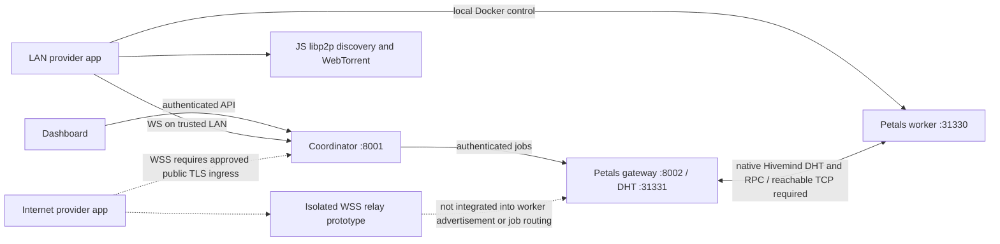

# Hybrid networking audit — 2026-11-07

## Result

**Partially implemented and locally tested; not production-ready.** The supplied Hybrid LAN and Global P2P requirements are not fully satisfied. Setting native relay flags, accepting circuit multiaddresses, labeling sockets LAN/WAN, and passing mock tests do not demonstrate Internet traversal or distributed model execution. This audit preserves the Phase 3 partial-validation checkpoint and the development fallback; it does not start a later roadmap phase or authorize hosting, release publication or distribution.

## Architecture and code evidence

The control plane is `orchestrator/app/main_production.py` (`websocket_seeder`, `ConnectionManager`) and `production_seeder.py` (`connect_to_orchestrator`, enrollment, heartbeat, hardware reporting). It authenticates a stable per-node bearer credential and waits for matching registration acknowledgment. The provider saves coordinator-bound settings; it does not automatically discover an authenticated alternative LAN/WAN coordinator endpoint.

`07-network-layer/src/libp2p_network.js` and provider `04-webtorrent-sync/src/libp2p_network.mjs` provide a separate TCP/Noise/mDNS/Kademlia overlay. WebTorrent transfer is separate again. Neither supplies a demonstrated Petals route. Native relay flags are enabled in the current Petals runtime, but a compatible reachable relay and successful native RPC have not been established by those flags.

`petals_control.py` prepares Docker addresses and assignments; `bootstrap_probe.py` tests container-side bootstrap; `gateway.py`, `worker.py`, `layer_server.py`, and `generate_job.py` carry native Petals execution. `distributed.py` handles allocation and job lifecycle. `11-evaluation-benchmark/petals_relay_prototype.py` remains an isolated authenticated TLS reverse-stream prototype, not a production connection manager.

## Bugs corrected

1. Added the missing coordinator `ipaddress` import: the real registration endpoint previously crashed despite the eleven mock hybrid tests passing.
2. Reserved new socket ownership before awaiting old-socket close. Superseded connect attempts cannot overwrite newer state; old buffered messages and heartbeat timeouts cannot mutate/close the replacement. Only a matching authenticated credential can take over its own identity.
3. Unified initial and recovery capacity checks in `provider_capacity` / `replacement_stage`. Reassignment now rejects paused, busy, quarantined, incompatible, insufficient-memory/disk and invalid-telemetry spares. CPU/CUDA selection is recomputed for the replacement rather than copied from the failed GPU peer. Missing/invalid resources are not invented.
4. Failed initial assignment delivery enters setup recovery. Cleanup tracks every attempted/reserved node, including replaced stages. A new socket's unrelated reservation is not cleared by old-job cleanup.
5. Loss or replacement of a socket during inference cancels the job and releases remaining stages. There is no unsupported KV-cache migration or token-resume claim. The operator can resubmit a fresh request; setup-stage reassignment is automatic when a capable spare exists.
6. Revoked clients no longer erase identity and automatically re-enroll using a remembered/default join secret. They stop with an actionable error and retain identity for operator recovery. Enrollment no longer accepts an unconditional built-in fallback, and the enrollment-code API no longer invents one. Existing configured codes remain operator-controlled.
7. Restored HTTP 410 on both unsigned legacy updater endpoints even when old feed files remain. The provider updater remains fail-closed. No releases were published.
8. Disabled automatic router port mapping in the Petals gateway. Users' routers are not silently modified. This does not add a substitute NAT traversal route.
9. Declared the already locked `@libp2p/ping` 3.1.14 dependency explicitly in coordinator/provider packages and lockfile roots. Replaced the broken network npm test command (which referenced an absent file) with an actual ephemeral overlay test. Optional discovery suppression permits isolated testing without multicast; normal discovery remains enabled.
10. Invalid telemetry no longer crashes the distributed status endpoint or reports a quarantined node ready. The network API explicitly labels its classification as socket observation and its global inference/automatic Petals relay validation as incomplete.

Provider shell changes were applied to canonical and legacy desktop sources. Existing hardware discovery, Docker checks, pause/disconnect, enrollment persistence, model execution, and secure updater containment were preserved. `ComputeTorrent-Provider-Node/` and the standalone `backend/` remain separate legacy trees, not the canonical execution path; they are not certified by these tests.

## Requirements matrix

| Requirement | Evidence / status |
| --- | --- |
| Trusted LAN control and direct overlay | Address policy, real loopback provider connection, ASGI coordinator registration and a real ephemeral TCP/Noise overlay connection/ping pass. Separate-PC Wi-Fi remains untested. |
| Stable identity, reconnect, heartbeat, duplicate ownership | Automated loopback/ASGI checks pass, including credential rejection, stale heartbeat, takeover, buffered stale message, ownership race and reconnect. Shared bearer credentials are not proof-of-possession keys. |
| Hardware-aware placement and failure recovery | Production scheduler executed with fixture gateway responses: capability rejection, setup replacement, assignment-delivery failure, no spare, inference disconnect and socket replacement pass. No actual model inference in these fixtures. |
| Automatic LAN/WAN selection | Missing: authenticated alternative endpoint descriptors, container-side direct route leases/probes, selection/hysteresis, and re-probe after NIC/address change. Socket IP labels are diagnostic only; private reverse-proxy addresses can mislabel WAN clients. |
| Global control without a VPN | WSS client policy exists. Requires operator-provisioned public server/ingress, DNS and trusted TLS. None provisioned or deployed by this task. |
| Global Petals relay fallback / CGNAT | Prototype TLS byte relay tests pass; job/workspace authorization, listener/advertisement mapping, bidirectional native sessions, stream multiplexing/half-close/backpressure and route admission remain integration work. No real CGNAT/firewall acceptance passed. |
| Petals activation transfer across actual devices | Unverified. Must demonstrate pinned runtime block advertisement, gateway stage discovery, RPC and small-model generation with two real workers on LAN and across the relay. |
| Resource limits and abuse prevention | Prototype role/lease/quota enforcement exists. Production relay ingress ACLs, admission/rate limits, per-workspace quotas and operational monitoring are not established. The JS relay must not be exposed publicly as an unrestricted service. |
| Power outage and recovery | Socket-loss/reconnect simulations only. No physical power interruption or automatic OS-login startup test. Active inference safely aborts; automatic resume from a token checkpoint is unsupported. |
| Update protections | Legacy feed retired and provider entrypoints disabled. Seven existing signed-updater tests still error because the current checkout lacks the previous verifier API (`SETUP` missing); this is an existing release blocker, not a passing security validation. |

## Test evidence and limits

- See `docs/testing-results.md` for exact suites and counts. New `test_hybrid_recovery.py` executes the actual scheduler endpoints and coordinator ownership paths rather than copying recovery logic into the test.
- Original `test_hybrid_networking.py` now documents its mock-only scope and prevents coordinator import from attempting the operator's real database. Its address labels and standalone digest comparison are not real WAN/authentication acceptance tests.
- Node's test worker initially encountered sandbox `spawn EPERM`. The authorized unsandboxed isolated loopback rerun passed. No project daemon, live Docker service or public endpoint was started/restarted.
- Installer `hybrid3` built before this audit does not contain these new source fixes. No new installer was built or distributed in this audit.

## Configuration and subsequent integration

For existing trusted-LAN development, use the coordinator's private address in `ws://<coordinator-LAN-IP>:8001/ws/seeder`, an explicitly configured operator enrollment code, and Docker on each worker. Check TCP 31331 (gateway bootstrap) and 31330 (worker RPC) between the actual host/container networks with operator-approved firewall rules. A control acknowledgment alone is insufficient. Never give another PC `127.0.0.1` as the coordinator address. Keep existing Tailscale development fallback available until the new data path passes acceptance.

For later WAN integration, provision an approved public HTTPS/WSS origin with hostname/certificate verification and a protected self-hosted relay. Keep relay credentials separate from provider enrollment and updater signing. Configure endpoints rather than embedding a private/public IP. Implement scoped outbound connectors and route leases; verify each candidate from the actual gateway and worker container, then admit allocations only on identity-verified routes. Test LAN preference, failed-direct fallback, WAN-to-LAN switching, expired credentials, proxy/WSS failure, relay restart, concurrent streams and native session cleanup. Do not expose the existing private TCP bootstrap/worker ports as a substitute for this design.

Public server/domain/TLS setup, live service reloads, cross-ISP/CGNAT devices, complete small-model cache, measured activation throughput/latency and a reviewed signed-updater restoration are outstanding dependencies. No cost, availability, seamless roaming or end-to-end inference guarantee is claimed. Phase 3 remains **Partially Validated — Remaining Integration Tests Pending**.
