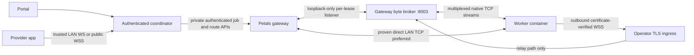

# Integrated Petals transport and TinyLlama diagnostics

2026-11-07. This supersedes the earlier statement that the WSS relay is only a prototype. The native transport integration now exists and real, isolated two-worker Transformer inference has passed. Real multiple-PC/ISP/CGNAT acceptance is still open: the operator confirmed that another system is currently unavailable. No public deployment or live service restart was performed by this work.

## Native Petals boundary

The pinned Petals/Hivemind APIs remain responsible for DHT discovery, peer identity, native TLS, block advertisements, RPC and inference/KV sessions. The WSS implementation is a ComputeTorrent engineering adapter carrying those TCP bytes; it is not a published Petals contribution, native circuit-relay reservation, or replacement inference protocol.

Upstream references: [pinned Petals Server](https://github.com/bigscience-workshop/petals/blob/22afba627a7eb4fcfe9418c49472c6a51334b8ac/src/petals/server/server.py), [reachability protocol](https://github.com/bigscience-workshop/petals/blob/22afba627a7eb4fcfe9418c49472c6a51334b8ac/src/petals/server/reachability.py), and [pinned Hivemind transport](https://github.com/learning-at-home/hivemind/blob/213bff98a62accb91f254e2afdccbf1d69ebdea9/hivemind/p2p/p2p_daemon.py).



The gateway/relay are co-located in the same container network namespace. Mapped worker listeners are **gateway-local 127.0.0.1 ports**, not addresses that arbitrary workers can dial. The production adapter opens separate native Petals sessions for each contiguous stage; the gateway passes activations between stages. Direct worker-to-worker WAN activation forwarding is not implemented or claimed. Moving the generation client to a separate host requires a different protected listener mapping and fresh validation.

## Implemented integration points

- `relay_transport.py`: one-use job/node-scoped leases, fixed forwarding targets, 32 leases by default, 16 concurrent streams per side, 64 KiB payload frames, 1 GiB incoming payload quota per endpoint, bounded WebSocket queues, timeouts, native TCP half-close and revocation. No caller-chosen forwarding host/port. Worker WSS verifies certificates and hostnames and refuses redirects. Gateway mapped listeners bind only loopback. Per-assignment public URLs do not mutate another lease's origin.
- `gateway.py`: authenticated create/probe/revoke route endpoints; bounded relay listener startup; native peer-ID bootstrap verification before generation; a local reachability service; loopback bootstrap for its own helper to avoid Docker Desktop hairpinning. An ingress terminates public TLS; raw port 8003 is bound to host loopback by Compose.
- `route_selection.py` and `worker.py`: a positive native reverse-reachability probe prefers direct LAN when relay fallback is available. Failed/unknown reachability selects outbound WSS. Both worker-to-gateway bootstrap and gateway-to-worker RPC traverse the mapping. No active KV session is moved between routes. Relay loss stops the worker; the coordinator fails/cleans the request and supports fresh resubmission.
- `layer_server.py`: direct workers are full DHT peers; WSS-mapped workers use client mode. The previous hardcoded relay-only setting is removed. Public `health.petals.dev` validation is bypassed for this private swarm, while native TLS, expected peer identities, gateway route probes and real stage coverage remain enforced.
- `distributed.py`: leases attached to actual assignments/replacements, relay protocol capability checking, expected worker identity probes for WSS stages, and lease revocation during terminal cleanup. Existing capacity/throughput engineering changes made in parallel were preserved.
- `control_routes.py` / provider `connection_routes.py`: at most four operator-authorized endpoints. Alternatives learned from the registered coordinator are scoped to the original primary. Per-node nonce/HMAC identity probes precede selection; alternate WebSocket registration uses mutually verified, fresh, domain-separated challenges, without transmitting the provider bearer secret. LAN is preferred on reconnect; idle WAN connections periodically reconsider positively verified LAN candidates. Busy inference is not migrated. Identity and settings persist across supported network changes.
- `generate_job.py`: explicit shutdown of stage sequence managers and their shared client DHT after success/failure avoids retaining native background processes after generation.

Native relay flags alone are not treated as proof. External native Circuit Relay v2 compatibility remains a distinct validation question; this WSS bridge does not depend on a successful native circuit reservation. The JS libp2p/WebTorrent overlay is separate from Petals activations.

## Configuration (prepare only; do not deploy without approval)

`COMPUTETORRENT_PROVIDER_ENDPOINTS` is a JSON array, for example:

```dotenv
COMPUTETORRENT_PROVIDER_ENDPOINTS=["ws://192.168.100.7:8001/ws/seeder","wss://coordinator.example/ws/seeder"]
PETALS_RELAY_PUBLIC_URL=wss://coordinator.example/ws/petals-relay
COMPUTETORRENT_PETALS_NETWORK_POLICY=auto
```

These are examples, not provisioned endpoints. The relay URL must end in `/ws/petals-relay`, use WSS and a valid trusted certificate, and preserve the route suffix when proxied. `auto` probes direct then falls back; `relay` forces WSS for acceptance testing; `direct` refuses a failed reverse probe when fallback configuration is present. A nonconfigured ordinary LAN setup preserves its direct behavior. Private addresses cannot work from unrelated Internet networks.

The gateway must be hosted where an approved public TLS ingress can reach it. Provider PCs need outbound WSS, no third-party VPN or router changes. A private home coordinator cannot become globally reachable merely by setting a public URL. Existing operator-created tunnel configuration was preserved, but was not used as CGNAT acceptance evidence or deployed by this work.

Ingress routing must preserve paths:

```caddyfile
coordinator.example {
    handle /ws/petals-relay/* {
        reverse_proxy 127.0.0.1:8003
    }
    handle /ws/seeder {
        reverse_proxy 127.0.0.1:8001
    }
    handle /api/seeders/enroll {
        reverse_proxy 127.0.0.1:8001
    }
    handle /api/network/identity {
        reverse_proxy 127.0.0.1:8001
    }
    respond 404
}
```

This snippet does not expose operator/admin APIs or the updater. The operator must configure ingress connection/rate limits, certificate renewal, capacity/egress monitoring, and firewall restrictions before any public trial. WSS has TCP head-of-line constraints; independent streams are bounded but still share one WebSocket. No measured WAN availability, cost or latency target is claimed.

## TinyLlama screenshot investigation

Job `bcae8683aa324745a5a4f5fcffdfae48` reported a generic exit on peer `…4917ef5e565`; local artifacts belonged to the other peer `…7f0d4644c41b`. The failed peer's original traceback was unavailable and its container was no longer retained locally. Therefore the exact cause of this particular crash is **not established**.

Read-only cache inspection for `TinyLlama/TinyLlama-1.1B-Chat-v1.0` revision `fe8a4ea1ffedaf415f4da2f062534de366a451e6` found config metadata but none of `model.safetensors`, its index, or `pytorch_model.bin`. This is incomplete local cache evidence, not proof of the other peer's root cause. No full model weights were downloaded by the investigation.

Worker diagnostics now save bounded `layer.log`, lead with the actual final Python exception in `status.json`, redact bearer/HF credentials and URL queries in forwarded details, and retain a container log before cleanup. Host OOM detection reports the Docker memory limit explicitly. Logs remain in the provider's `petals/<job-id>/` directory even after container removal. Old already-deleted logs cannot be reconstructed; a new run using the rebuilt runtime is required to capture this specific failure if it recurs.

## Verification evidence

`smoke_integrated_petals_relay.py` runs offline with no published ports, two real native Petals worker processes, complementary layer ranges and tiny random checkpoints. Model dimensions are deliberately small: these are functional integration fixtures, not trained TinyLlama-1.1B or BLOOM-560M quality/performance tests.

| Fixture | Result | Payload after worker startup |
| --- | --- | ---: |
| Tiny Llama/GQA, 2 layers on 2 peers | Native generation matched local reference. Production stage-by-stage pipeline completed, boundary replay passed and canary passed. Process exited 0. | 31,460 bytes |
| Tiny BLOOM, 2 layers on 2 peers | Native generation matched local reference. Production stage-by-stage pipeline completed, boundary replay passed and canary passed. Process exited 0. | 37,508 bytes |

Both use the integrated TLS/WSS transport and pinned Petals image, with host websockets 13.1 mounted read-only because the cached image did not contain it. Updated runtime recipes install that dependency. The BLOOM fixture adds local block-key aliases required by Petals' BLOOM config; Transformers warns about those extra aliases when loading the reference. They refer to the same fixture tensors and no model output was fabricated. Initial fixture API/key/wait-order errors were corrected before the successful runs.

Reproduce from the repo root with the cached pinned image and Python websockets installed:

```powershell
$fixtureWs = python -c "import pathlib,websockets; print(pathlib.Path(websockets.__file__).parent)"
$fixtureRuntime = (Resolve-Path 08-provider-node/06-petals-runtime).Path
$fixtureBench = (Resolve-Path 11-evaluation-benchmark).Path
foreach ($architecture in @('llama', 'bloom')) {
    docker run --rm --network none --cpus 2 --memory 5g `
      -e "CT_FIXTURE_MODEL=$architecture" -e HF_HUB_OFFLINE=1 -e TRANSFORMERS_OFFLINE=1 `
      -e PYTHONPATH=/fixture:/app:/smoke `
      --mount "type=bind,source=$fixtureWs,target=/fixture/websockets,readonly" `
      --mount "type=bind,source=$fixtureRuntime,target=/app,readonly" `
      --mount "type=bind,source=$fixtureBench,target=/smoke,readonly" `
      --entrypoint timeout computetorrent-petals:local 240s `
      python -B /smoke/smoke_integrated_petals_relay.py
    if ($LASTEXITCODE -ne 0) { throw "Native $architecture integration failed" }
}
```

These runs verify actual native DHT discovery, serving, RPC, activation transfer, generation, boundary checks and cleanup inside an isolated host. They do not simulate successful real-CGNAT or multiple-PC tests. Phase 3 remains partially validated pending physical network acceptance. Updater behavior is operator-controlled and was left unchanged after the explicit instruction not to touch it; updater-related regression failures are reported separately, not silently removed.
